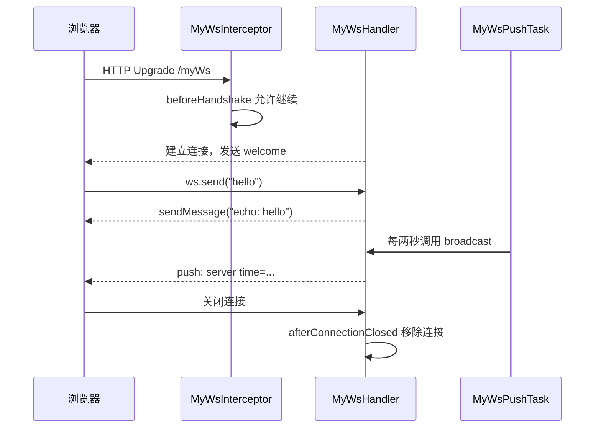

# 用这个例子学习 WebSocket

这个包演示 Spring WebSocket 的文本消息 API。它不读写数据库，也不使用登录身份。

先看[方法调用关系图](../../../../../../../../docs/websocket-call-map.md)，再沿图中的路径阅读下面的代码说明。

## 先运行并观察

在 `backend` 目录启动博客后端。下面的参数会让已有数据库只做结构校验，不自动修改表或执行初始化 SQL：

```powershell
.\mvnw.cmd spring-boot:run "-Dspring-boot.run.arguments=--spring.jpa.hibernate.ddl-auto=validate --spring.sql.init.mode=never"
```

后端正常启动后，在浏览器访问：

```text
http://localhost:8081/ws-client.html
```

如果你修改了后端端口，页面地址也改用对应端口。页面会根据当前地址自动选择 `ws://` 或 `wss://` 并连接 `/myWs`。

1. 点击“连接”。连接建立时服务端会发送 `welcome: clientId=1`，浏览器也会自动发送 `hello`，并收到 `echo: hello`。
2. 保持页面打开。即使不再发送消息，也会每两秒收到 `push: server time=...`。这就是服务端主动推送。
3. 打开第二个标签页，再连接一次。两页的连接编号不同；两页都收到定时推送，输入消息后的 echo 只发给发送它的页面。
4. 点击“断开”。观察后端 `WebSocket closed` 日志中的在线连接数量。重连会获得新的连接编号。
5. 浏览器开发者工具打开 Network → WS，查看 `/myWs` 的握手和消息记录。正常的 HTTP/1.1 WebSocket 握手响应是 `101 Switching Protocols`。

## 顺着一次通信读代码



- [MyWsConfig.java](MyWsConfig.java)：`@EnableWebSocket` 启用 WebSocket 配置，`addHandler` 将 `/myWs` 绑定到处理器，`addInterceptors` 注册握手拦截器。`@EnableScheduling` 启用示例的定时任务。
- [MyWsInterceptor.java](MyWsInterceptor.java)：处理 HTTP 握手阶段。`beforeHandshake` 返回 `true` 才继续；`afterHandshake` 表示握手阶段结束，不表示连接断开。当前只记录日志，不校验登录，也不复制 HTTP Session。
- [MyWsHandler.java](MyWsHandler.java)：处理连接建立、收到文本、传输异常和连接关闭。先读 `afterConnectionEstablished`，再读 `handleTextMessage`，最后读清理方法。
- [SessionBean.java](SessionBean.java)：保存一条连接及其编号。`WebSocketSession` 代表 WebSocket 连接，和保存登录状态的 `HttpSession` 是不同对象。`clientId` 是服务端分配的演示编号，不是用户 ID。
- [MyWsPushTask.java](MyWsPushTask.java)：定时调用 `broadcast`，向当前所有连接发送时间。推送不是对某个 HTTP 请求的响应。
- `src/main/resources/static/ws-client.html`：浏览器端入口。依次读 `new WebSocket`、`onopen`、`send`、`onmessage`、`onclose`。

你之前练习 TCP 时用 `ServerSocket.accept()` 接收连接、用输入输出流收发数据；这里框架负责握手、WebSocket 帧解析和回调调度，你在回调中处理消息。握手成功后的每次 `send` 都是在同一条连接上传送 WebSocket 消息，不是重新发一次 HTTP 请求。

这个例子使用 `WebSocketConfigurer` + `TextWebSocketHandler`，无需再添加 Jakarta `@ServerEndpoint` 或 `ServerEndpointExporter`。

## 为什么这样保存和发送连接

Handler 默认是 Spring 单例，一个实例可以处理许多连接，所以 Map 使用 Spring 提供的连接 ID 作为 key，使用 `ConcurrentHashMap` 支持多个线程访问。Map 和编号生成器属于这个 Handler 实例，无需设为 `static`。

集合的线程安全只保护集合本身。接收消息的线程和定时任务线程仍可能同时向同一连接发送消息，因此建立连接时用 `ConcurrentWebSocketSessionDecorator` 包装一次。欢迎消息、echo 和推送全部通过 Map 中同一个包装对象发送。

正常关闭、传输异常和发送失败都会移除对应连接。某个连接发送失败时，只清理它；其他连接仍然可以收到推送。异常关闭使用 WebSocket 关闭码，而不是在已升级的连接上返回 HTTP 错误响应。

## 建议打断点的位置

1. 在 `beforeHandshake`、`afterHandshake` 和 `afterConnectionEstablished` 打断点，再点击连接。观察握手和连接回调的区别。
2. 在 `handleTextMessage` 打断点，输入一句话。查看 `message.getPayload()`、`session.getId()` 和 Map 中的连接。
3. 在 `MyWsPushTask.sendMsg()` 打断点。浏览器不发送数据时，它依然会被定时调用。
4. 在 `afterConnectionClosed` 打断点，点击断开。确认对应条目被移除。

`afterHandshake` 和连接回调由框架及底层容器触发，业务代码无需依赖它们之间固定的先后顺序。

WebSocket 默认做同源检查，所以通过后端提供的页面练习，不要双击 HTML 以 `file://` 打开。后续接入其他前端来源时，应明确配置允许的来源；来源检查和用户登录校验各有自己的职责。

## 验证和小练习

只运行本示例的自动化测试：

```powershell
.\mvnw.cmd "-Dtest=MyWs*Test" test
```

测试使用独立的随机端口应用上下文，排除数据源配置，不连接开发数据库。

先试着把 `echo: ` 改成你自己的回复，然后修改 `MyWsPushTask` 的内容，观察哪条路径负责回复、哪条路径负责主动推送。需要放慢推送时，可在启动参数中追加 `--demo.websocket.push-delay-ms=10000`，让间隔变成十秒。

如果以后用它实现博客通知或游戏，业务规则和资源权限仍应放在对应 Service，登录 Session 仍由 `auth` 包处理。

参考：[Spring WebSocket API](https://docs.spring.io/spring-framework/reference/web/websocket/server.html)、[ConcurrentWebSocketSessionDecorator](https://docs.spring.io/spring-framework/docs/7.0.9/javadoc-api/org/springframework/web/socket/handler/ConcurrentWebSocketSessionDecorator.html)。
