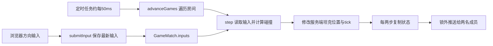

# 阶段报告：后端房间运行与双人移动

2026-11-18。代码和基础检查已完成，真实画面与操作由用户分步手测。本阶段入口为博客导航“坦克大战”或 `/game`，原 `/game/ws-test` 保留。

## 本阶段产出

- 房间增加 WAITING、LOADING、PLAYING 状态，并为每局生成独立 matchId。
- 地图读取在房间锁外执行；每局验证并深复制布局，双方加载资源完成后才推进位置。
- 服务器每步模拟 50ms，速度 120px/s，因此单步最大移动 6px；每两步广播一次完整状态。
- 输入只携带房间、对局、方向与递增 seq，不接受客户端坐标或速度。500ms 没有新输入会停止移动。
- 服务端检测边界、砖墙、钢墙、河流和其他坦克；空地、树林、冰面可通过。采用轴对齐路径扫掠，将位移截短到障碍前，避免只检查终点造成穿墙。
- 从最大可通行连通区域选择两个相距较远、互不重叠的出生点；地图布局不被对局修改。
- 前端显示同一局双方坦克，按服务端快照绘制；单轴移动做插值，不预测未知位置，转角不画斜线穿墙。
- 失焦、隐藏页面、断连、卸载时停止输入并清理监听、定时器与动画。
- 成员主动退出终止本次移动演示，发送 game:end，剩余房间回到 WAITING 并清准备；加载超过 30 秒也回到 WAITING。

## 后端运行模块

| 模块 | 文件与方法 | 职责 |
| --- | --- | --- |
| 房间内存 | `service/game/GameRoomService.java` 的 rooms、userRoomIds | 保存房间和用户所在房间索引 |
| 房间对象 | `game/runtime/GameRoom.java` | 成员、准备、status、version、matchId、加载期限、当前 match |
| 本局状态 | `game/runtime/GameMatch.java` | 地图副本、坦克列表、各用户最新输入、加载完成名单、tick |
| 输入入口 | `controller/GamePlayController.java` 的 input() | JSON 绑定与字段校验、读取连接身份 |
| 输入保存 | `GameRoomService.submitInput()` | 保存最新方向状态和服务端接收时间，忽略旧序号 |
| 定时驱动 | `service/game/GameMatchService.java` 的 tick() | 每隔约 50ms 调用房间服务，释放锁后发送快照 |
| 房间推进 | `GameRoomService.advanceGames()` | 遍历房间，检查加载期限，只推进 PLAYING 对局 |
| 移动碰撞 | `game/engine/GameMovementEngine.java` 的 step() | 固定步长位移、输入有效期、边界与障碍扫掠 |
| 状态发送 | `websocket/game/GameRoomNotifier.java` | 只向服务端确认的成员发送 game:start/state/end |
| 调度启用 | `config/GameLoopConfig.java` | 启用 Spring 定时任务；不导入该配置的测试可手动推进 |



控制消息线程和定时线程共用 GameRoomService 的同步方法，保证不会同时修改房间集合；数据库访问和网络投递不持有这把锁。当前采用这种单实例同步模型，没有引入命令队列、分布式房间或新基础设施。

## 消息契约

连接 `/ws/tankgame`，订阅 `/user/queue/replies`。

| 发送目标 | 请求字段 | 服务端结果 |
| --- | --- | --- |
| `/app/room/start` | roomId | room:started、room:updated、game:init |
| `/app/game/loaded` | roomId、matchId | 双方完成后 game:start |
| `/app/player/input` | roomId、matchId、seq、direction | 不逐条确认；在 game:state 中返回权威坐标及 lastInputSeq |
| `/app/game/sync` | roomId | 当前账号收到 room:updated 和可用的 game:init |

RoomResponse 增加 status 和 matchId。game:init 包含 roomId、matchId、roomVersion、map、rules、state；game:start 与 game:state 包含 roomId、matchId、status、tick、serverTime 和 tanks。每辆坦克包含 userId、x、y、size、direction、lastInputSeq。

direction：0上、1下、2左、3右、null停止。前端变化时立即发送，运行期间每100ms续发完整方向；刷新恢复时从服务端 lastInputSeq 之后继续编号。roomVersion、matchId、tick 共同防止迟到初始化或旧状态覆盖新局。新消息目标已加入入站白名单。

## 验证

后端相关测试 77 项通过，0 失败、0 错误、0 跳过，其中含 16 项纯移动碰撞规则测试、14 项对局流程测试、2 项真实 STOMP 集成测试，以及原房间/通知/输入目标校验回归。网络集成测试在隔离上下文使用测试身份与地图，排除数据库连接，覆盖双用户开局、加载、移动、同步和退出；没有修改开发数据库。

前端生产构建、Vue/TypeScript 类型检查、相关文件 ESLint 与格式检查通过。真实双浏览器画面、键盘手感仍等待用户手测。

09:24:02 已重启正确的 `blog-ai` 后端，监听 8081。启动日志确认加载 `blog-ai\backend\target\classes`，使用 `ddl-auto=validate` 和 `spring.sql.init.mode=never`；匿名查询当前用户正常返回401。运行日志在 `backend/target/backend-manual-test.log`，重启后需要重新登录。

```powershell
cd D:\code\springboot\blog-ai\backend
.\mvnw.cmd test "-Dtest=GameRoomServiceTest,GameMessageControllerTest,GameMessageChannelInterceptorTest,com.syf.blog.dto.game.room.RoomRequestValidationTest,GameMovementEngineTest,GameMatchServiceTest,GameMovementIntegrationTest" "-Dspring.jpa.hibernate.ddl-auto=validate" "-Dspring.sql.init.mode=never" "-Ddebug=false"
```

## 分步手测

1. 刷新并重新登录，在两个独立浏览器环境中打开 `/game`，每个账号只开一个游戏页。
2. 连接、创建/加入同一房间、双方准备、房主点击开始。确认两边进入同一战场。
3. 点击各自画布，用方向键或 WASD 移动，确认双方看到的位置一致；松键应停止。
4. 持续向边界、砖墙、钢墙、河流移动，确认停在障碍前；树林和冰面可通过。
5. 尝试让两辆坦克靠近，确认不会重叠或互相穿过。
6. 按住方向后切换窗口，确认停止；刷新后重新连接并取回房间，使用“恢复战场”同步。
7. 其中一方主动退出，另一方应回到等待状态，准备清空，可以重新组成一局。

## 当前限制

只读检查发现现有数据库地图1为 4行×6列、每格24px 的材质测试布局，因此当前战场很小，只适合验证移动与不同材质碰撞。本阶段没有改动数据库地图；正式联机地图可作为独立步骤处理。

当前尚未实现射击、伤害、胜负、断线席位超时回收、服务端登出撤销、多连接接管或多实例部署。输入过期会停止坦克，但不会自动释放房间。调度使用 fixedDelay，单步规则固定50ms，服务端过载时实际模拟频率会下降，不使用客户端时间补偿位移。

后续按用户要求逐模块解释与验证，当前先讲后端房间的存储、输入、定时推进、碰撞和广播，不继续增加功能。
