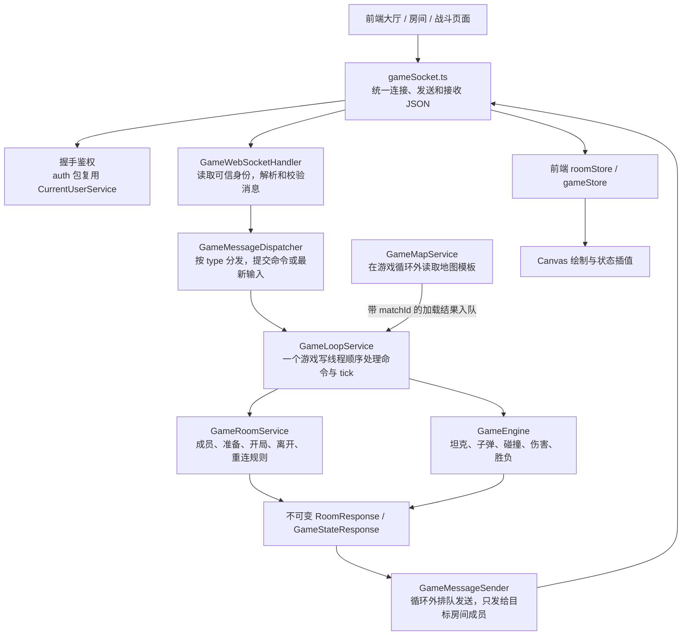
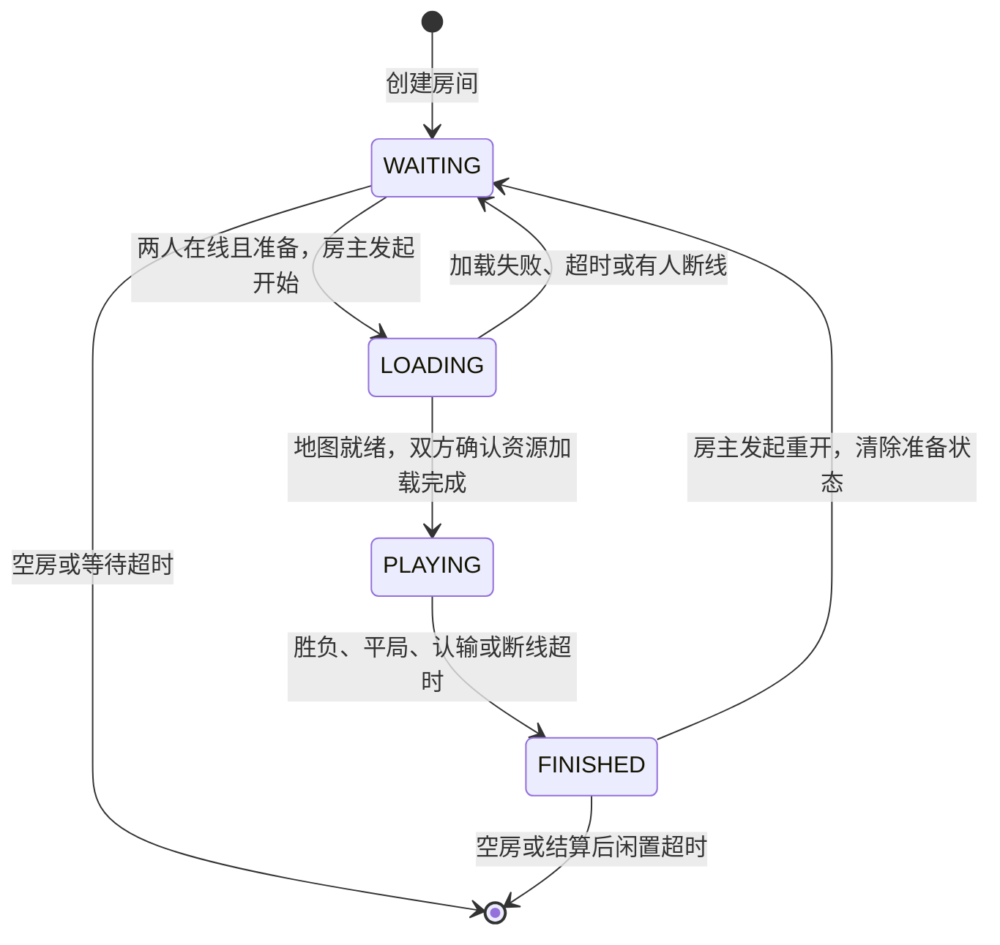

# 坦克大战：房间与 WebSocket 设计草案

这份方案对应当前博客仓库的实际代码，作为接下来分步实现的依据。下文的类名、消息和频率均为建议设计，游戏联机功能尚未实现。

## 1. 当前基础与首版目标

当前已经具备：

- `GameView.vue`：请求地图、Canvas 持续绘制、键盘方向输入。
- `GameMapController → GameMapService → GameMapRepository`：从数据库读取地图模板。
- `CurrentUserService`：读取现有登录 Session，查询用户是否有效。
- `test/MyWs*`：握手、回显、广播和关闭清理的教学示例。

建议首版采用以下规则：

| 项目 | 建议 |
| --- | --- |
| 运行方式 | 游戏模块运行在现有 Spring Boot 进程内，先部署一个后端实例 |
| 玩家身份 | 复用博客登录账号，握手时由服务端确认身份 |
| 房间人数 | 每房间两人，每个账号同时占用一个房间和一条有效游戏连接 |
| 地图 | 先使用已有的地图 1；每局复制独立地图状态 |
| 房间操作 | 查询、创建、加入、准备、开始、退出统一走 `/ws/game` |
| HTTP | 继续负责登录、地图查询；现有 `/api/game/maps/{id}` 保持原契约 |
| 状态保存 | 房间、坦克、子弹和输入保存在内存，用户及地图模板继续保存在数据库 |
| 胜负 | 服务端计算移动、碰撞、伤害、死亡和胜负；客户端显示结果 |

房间表示“一组共同游戏的玩家”；WebSocket 表示“一个浏览器与服务端的连接”。玩家刷新后连接会改变，房间中的成员身份仍使用登录用户 ID。

## 2. 整体调用关系



握手鉴权发生在建立连接时。之后的每条消息都从连接绑定的身份读取 userId，进入同一套房间和游戏规则。

## 3. 后端模块与具体功能

| 模块 | 建议类与位置 | 具体功能 |
| --- | --- | --- |
| WebSocket 配置 | `config/GameWebSocketConfig` | 注册 `/ws/game`、处理器、握手拦截器和明确的允许来源 |
| 登录鉴权 | `auth/GameSocketAuthService`、会话失效监听组件 | 握手时复用 `CurrentUserService`；将可信 userId、HTTP Session 标识绑定到连接；登出、身份切换、Session 失效后关闭相关连接 |
| 连接管理 | `websocket/game/GameConnectionRegistry` | 维护 userId 与有效连接的对应关系；给连接分配代次；处理新连接接管、心跳和断线事件 |
| 消息入口 | `websocket/game/GameWebSocketHandler`、`GameMessageDispatcher` | 解析 JSON，校验 type、字段和长度，限制频率，按消息类型提交命令；处理关闭和传输异常 |
| 房间业务 | `service/game/GameRoomService` | 查询、创建、加入、准备、房主开始、退出、房主转移、重开；检查人数、成员身份和允许的房间状态 |
| 房间登记表 | `game/runtime/GameRoomRegistry` | 保存 roomId→房间、房间号→roomId、userId→roomId；由游戏写线程统一维护一致性 |
| 游戏运行调度 | `service/game/GameLoopService` | 定时处理控制命令、应用最新输入、推进战局、检查加载和重连期限、生成快照 |
| 游戏规则 | `game/engine/GameEngine` 及移动、碰撞、战斗规则类 | 推进坦克位置、限制地图边界和阻挡、开火冷却、子弹移动、命中、伤害、死亡及胜负 |
| 地图运行状态 | 复用 `GameMapService`，新增内存地图模型 | 开局加载并固定地图模板版本，深复制本局墙体；本局砖墙破坏只修改这份副本 |
| 对外消息与发送 | `dto/game/...`、`websocket/game/GameMessageSender` | 将内部状态转换为明确响应 DTO；按房间成员发送；串行协调单连接发送，管理有界发送队列 |

职责约定：

- Handler 处理协议和传输，业务权限及状态转换由 `GameRoomService` 等业务服务检查。
- Servlet、HTTP Session 细节集中在 `auth` 包；房间和游戏服务接收可信 userId 及业务参数。
- 内存状态放在 `game/runtime`，地图等 JPA 实体继续放在 `domain`。
- 请求和响应 DTO 使用 `XxxRequest`、`XxxResponse`，补充校验和 `@Schema`；DTO 不作为 JPA 实体。
- HTTP 业务失败仍交给 `GlobalExceptionHandler`；已升级的 WebSocket 消息失败由消息入口转换成 `error` 响应。

## 4. 核心内存对象

| 对象 | 主要字段 | 用途 |
| --- | --- | --- |
| `GameConnection` | userId、httpSessionId、connectionGeneration、WebSocketSession、lastSeenAt | 记录当前有效通信连接，属于传输层；Session 标识只在服务端内部使用 |
| `GameRoom` | roomId、roomCode、ownerUserId、mapId、status、version、members、currentMatch | 保存房间成员及生命周期 |
| `RoomMember` | userId、displayName、slot、ready、connected、reconnectDeadline | 保存成员身份、席位、准备和断线状态 |
| `GameMatch` | matchId、mapVersion、mapSnapshot、tick、loadedPlayers、tanks、bullets、destroyedCells、result | 保存一局战斗状态；每次开新局使用新的 matchId |
| `PlayerInput` | connectionGeneration、matchId、seq、direction、fireHeld、receivedAt | 保存玩家最近一次完整的按键状态 |
| `TankState` | userId、x、y、direction、hp、alive、fireCooldown | 服务端计算的坦克状态 |
| `BulletState` | bulletId、ownerUserId、x、y、direction、speed | 服务端计算的子弹状态 |

房间保存成员的 userId，发送时再从连接登记表查有效连接。浏览器重连后，房间成员可绑定新的连接。

## 5. 房间生命周期与规则



| 操作 | 服务端规则 |
| --- | --- |
| 创建 | 必须登录、有有效连接、当前未在别的房间；生成 roomId 和不重复的展示房间号，创建者为房主 |
| 加入 | 房间存在、处于 WAITING、有空位；同账号重复请求可返回当前状态，不能占两个席位 |
| 准备 | 仅 WAITING 中的在线成员可修改自己的 ready；每次变化广播最新 `room:state` |
| 开始 | 仅房主可发起，要求两人在线且都 ready；原子地切换 LOADING，创建 matchId，重复开始不能再创建新局 |
| 加载 | 循环外读地图，带 roomId、matchId 返回结果；向双方发送 `game:init`；双方加载完成后发送 `game:loaded` 确认 |
| 正式开局 | 仅当前 matchId 的两名有效连接都加载完成时切换 PLAYING，发送 `game:start` |
| 主动退出 | WAITING 中移除成员；房主退出时转给剩余成员；LOADING 中退出取消开局；PLAYING 中退出按认输结算 |
| 结束 | 发送 `game:end` 并停止本局物理推进；保留短暂结果供显示和断线恢复 |
| 重开 | 房主发起返回 WAITING，清空双方 ready；下一次开始创建新的 matchId 和地图副本 |

成员变化、准备变化、状态转换都会增加 room.version，并向该房间成员广播。加入、开始和重开时，均由服务端校验当前状态。

## 6. WebSocket 消息设计

连接地址建议使用 `/ws/game`。前端使用当前站点域名，HTTP 页面对应 ws，HTTPS 页面对应 wss。

统一 JSON 外层：

```json
{
  "type": "room:join",
  "requestId": "req-1001",
  "payload": {
    "roomCode": "483921"
  }
}
```

`type` 表示消息功能，`requestId` 用于对应一次业务操作及去重，`payload` 是该消息的参数。服务端身份来自连接绑定信息。准备、移动等操作的房间从当前成员关系查找，客户端携带的房间标识也需要核验。

### 客户端发出的消息

| type | 主要参数 | 功能 |
| --- | --- | --- |
| `room:list` | 分页或数量上限 | 查看可加入房间，首页主动刷新 |
| `room:create` | mapId，首版固定已有地图 | 创建房间并自动占一个席位 |
| `room:join` | roomCode | 加入房间 |
| `player:ready` | ready | 设置自己的准备状态 |
| `room:start` | requestId | 房主申请开始 |
| `game:loaded` | matchId、mapVersion | 确认本局地图和资源已经加载 |
| `player:input` | matchId、seq、direction、fireHeld | 提交移动和持续开火状态 |
| `room:leave` | requestId | 主动退出房间或认输 |
| `room:rematch` | requestId | 房主申请返回等待状态 |
| `room:sync` | 当前已知版本，可省略 | 重连后请求自己的房间与当前战局快照 |
| `ping` | 客户端时间 | 应用层心跳 |

### 服务端发出的消息

| type | 主要内容 | 功能 |
| --- | --- | --- |
| `connection:ready` | 当前用户公开信息、连接代次 | 表示游戏连接已完成服务端登记 |
| `command:result` | requestId、操作结果 | 对创建、加入、准备等操作确认；重试同一请求可复用结果 |
| `room:list` | 有上限的房间公开列表 | 回应大厅查询 |
| `room:state` | roomId、房间号、房主、mapId、status、version、成员 ready/connected | 同步房间界面 |
| `game:init` | matchId、固定地图副本及版本、出生点、规则参数 | 开局前准备资源；双方随后确认加载 |
| `game:start` | matchId、初始战局快照 | 通知服务端正式开始推进本局 |
| `game:state` | matchId、tick、serverTime、坦克、子弹、已破坏墙体集合、已应用输入序号 | 同步权威战局 |
| `game:end` | matchId、winnerUserId 或平局、reason、最终状态 | 展示结算，重复到达时按 matchId 去重 |
| `error` | requestId、code、message | 例如 ROOM_FULL、NOT_ROOM_OWNER、NOT_READY、STALE_MATCH、BUSY |
| `pong` | 服务端时间及回传客户端时间 | 确认连接活性并估算延迟 |

输入示例：

```json
{
  "type": "player:input",
  "payload": {
    "matchId": "match-abc",
    "seq": 26,
    "direction": 3,
    "fireHeld": false
  }
}
```

`direction` 继续沿用当前项目约定：0 上、1 下、2 左、3 右、null 停止。`fireHeld` 表示是否持续按住开火键，由服务端冷却规则决定何时产生子弹。输入不携带可直接决定结果的位置、伤害和胜负。

## 7. 游戏推进、并发与发送

首版采用一个游戏写线程顺序管理所有房间，适合当前小规模学习版本。控制消息进入有界命令队列；高频输入保存为每名玩家的最新完整按键状态。

每个 tick：

1. 处理限定数量的创建、加入、准备、开始、退出、断线等控制命令。
2. 应用各玩家最新输入，再次检查当前连接代次、身份是否已撤销、房间成员关系、matchId 和递增 seq；超过输入有效期则清空移动和开火。
3. 推进 PLAYING 房间的移动、射击、子弹、碰撞、伤害和胜负。
4. 检查加载、重连和闲置期限；完成房间清理。
5. 生成不可变响应快照，投递给独立发送组件。

房间和战局可变状态只在游戏写线程内修改。数据库查询、身份查询和网络发送放在循环外；异步结果通过命令重新提交，附带当前 roomId、matchId 或连接代次，执行时丢弃已经过期的结果。

建议起步参数：

| 项目 | 初始建议 | 含义 |
| --- | --- | --- |
| 服务端模拟 | 20 次/秒 | 每个固定步长 50ms，服务端决定移动距离和冷却 |
| 状态广播 | 10 次/秒 | 每 100ms 推送最新完整动态状态 |
| 客户端输入 | 约 20 次/秒，输入变化时及时发送 | 输入为完整的 direction/fireHeld 状态，允许合并尚未应用的旧输入 |
| 输入有效期 | 初始建议 500ms | 长时间未收到按键状态刷新时，停止移动和持续开火，避免按键滞留 |
| 前端绘制 | requestAnimationFrame | 跟随浏览器刷新，用快照插值平滑画面 |
| 心跳 | 约每 5 秒 | 无有效消息约 15 秒时由服务端标记断线 |
| 断线保留 | 检测到断线后 15 秒 | 给同账号重连机会 |
| 地图加载期限 | 30 秒 | 到期取消加载，回到 WAITING 并清空 ready |
| 等待房间闲置 | 10 分钟 | 没有有效房间操作时回收；心跳不作为房间业务操作 |
| 结算房间闲置 | 5 分钟 | 回收长期停留的结算房间 |

这些参数是实现起点，需要用实际画面、延迟和运行负载验证。移动、射击等按固定模拟步长计算，广播频率和画面刷新率分别控制。

发送组件为每条连接提供有界、保序的发送通道：欢迎、房间变化、初始化、结算等消息可靠排队；尚未发送的旧 `game:state` 可以被更新快照替换。所有发送通过同一个连接包装对象，使用 `ConcurrentWebSocketSessionDecorator` 协调并发。慢连接超过发送限制时关闭，并向游戏线程提交断线事件。[Spring 发送约束](https://docs.spring.io/spring-framework/reference/web/websocket/server.html)

控制队列满时明确回复 BUSY。每 tick 限制控制命令处理量，保证物理推进仍能进行。普通命令的 requestId 结果缓存设置容量和有效期；重复操作仍需验证当前身份。输入序号在本局当前连接代次内递增，重连后使用新的代次并重新计数。

## 8. 掉线、重连与身份失效

| 情况 | 建议行为 |
| --- | --- |
| WAITING 中掉线 | 清除该成员 ready，保留席位 15 秒；期间不允许开始；超时移除，必要时转移房主 |
| LOADING 中掉线或连接被替换 | 取消本次开局，回到 WAITING，清除双方 ready；迟到的地图结果和加载确认按 matchId 丢弃 |
| PLAYING 中掉线 | 立即清空移动和开火输入；坦克保留在战场，战局继续推进；保留重连机会 15 秒，仍可能因本局正常战斗先产生结果 |
| 断线期限结束 | 仍在 PLAYING 时判断线方负；双方都已离线且无法继续时结束为中止，无胜者 |
| 同账号重连 | 重新验证登录，替换旧连接，重置输入和 seq、取消旧断线期限，发送当前房间及战局全量快照 |
| 新连接接管 WAITING 席位 | 清除原连接的 ready，向房内广播新状态 |
| 旧连接随后触发关闭回调 | 只有连接代次仍匹配当前有效连接时，才提交其断线；避免误删重连后的有效连接 |
| 主动退出 PLAYING | 明确认输，无断线保留期 |
| 退出登录、身份切换、Session 失效 | auth 包关闭关联游戏连接，房间按已确认的离线规则处理；身份失效期间禁止继续提交操作 |
| 账号被停用 | 停用操作主动撤销连接，或由低频后台复核撤销；避免每个输入都查询数据库 |
| 空房 | 立即移除房间和索引；结束本局计算并释放输入、快照及结果引用 |
| 后端重启 | 内存房间清空；客户端提示房间已结束并回到大厅 |

入队后尚未执行的消息也必须复核连接代次，防止旧连接留下的输入在新连接接管后执行。身份撤销时先把关联连接标记为不可用，再关闭 socket；游戏线程执行命令前同样检查撤销状态。网络发送失败只能提交带代次的断线事件，由游戏线程修改业务状态。

`ping/pong` 是本方案的应用层心跳，用于连接活性检查；登录 Session 的有效期仍由现有认证机制管理。

## 9. 地图与服务端规则

开局先进入 LOADING，地图读取任务在游戏循环外调用 `GameMapService`，将结果连同本次 matchId 提交回来。确认仍是当前加载中的对局后，深复制 seed 并固定本局 mapVersion，随后发送 `game:init`。

前后端使用同一份本局布局，世界尺寸从行数、列数和 tileSize 推导。当前地图接口尚无出生点字段，首版可在游戏规则配置中给地图 1 指定两个出生点，并在开局时校验其可通行、互不重叠。

规则模块至少包含：

- 移动：按方向、服务端速度和固定步长更新，限制边界、墙体及坦克重叠。
- 射击：按 fireHeld 和服务端开火间隔生成子弹，限制子弹数量。
- 碰撞：计算子弹沿途碰撞，避免速度较快时跳过障碍；砖墙破坏写入本局 destroyedCells。
- 材质：按现有 0～5 编号明确空地、砖墙、钢墙、河流、树林、冰面的移动及子弹规则；首版冰面可以使用普通地面移动规则。
- 结算：处理血量归零、主动认输、断线超时和对局时间上限；同一 tick 双方死亡可判平局。

数据库保存地图模板；同一张地图上同时发生的两局游戏，各自持有独立的墙体和子弹状态。

## 10. 前端模块与现有代码接入

| 模块 | 建议文件 | 具体功能 |
| --- | --- | --- |
| 游戏大厅 | `views/GameLobbyView.vue`，路由 `/game` | 连接游戏服务、创建房间、输入房间号加入、刷新可加入房间列表、显示错误 |
| 房间及战斗页 | `views/GameRoomView.vue`，路由 `/game/rooms/:roomId` | 玩家列表、房主、ready、开始、加载进度、退出、战斗 Canvas、结算和重开 |
| 连接层 | `game/network/gameSocket.ts` | 单一有效连接、JSON 编解码、requestId、心跳、重连、错误提示；大厅到房间导航时复用连接 |
| 消息类型 | `game/network/protocol.ts` | 对应后端 DTO 的 TypeScript 类型，统一消息名称和参数 |
| 客户端状态 | `game/state/roomStore.ts`、`gameStore.ts` | 保存房间快照和战局快照，按 version/tick/matchId 接受新状态，清理上一局数据 |
| 输入 | 现有 `keyboardInput.ts` + 新增输入发送模块 | 保留 0～3/null 方向约定；增加 fireHeld、seq；失焦、离开、断线时清空按键 |
| 绘制 | 复用 `mapLoader.ts`、`playRenderer.ts`、requestAnimationFrame | 将绘制对象扩展为服务端快照中的两辆坦克、子弹和血量；快照间插值；墙体破坏后刷新地图缓存 |

现有 `GameView.vue` 中硬编码读取地图 1 的初始化流程，应在联机页改为接收 `game:init` 的本局地图。键盘回调改为提交输入；坦克的 x、y、hp 从服务端状态更新。

房间操作成功后的 UI 以服务端 `room:state` 为准。收到 `game:init` 后加载地图和素材，完成才发送 `game:loaded`；收到 `game:start` 后进入战斗显示。刷新房间页先恢复登录及连接，再执行 `room:sync`。

## 11. 本地与部署接入

- 当前 Vite 只代理 `/api`，实现时需增加 `/ws` 的 WebSocket 代理，并对实际开发页面 Origin 明确放行。[Vite 代理配置](https://vite.dev/guide/api-javascript)
- 浏览器通过当前站点地址连接 `/ws/game`，复用同源登录 Cookie。
- 当前 Nginx 只配置了 API 和静态页面，需增加 `/ws/` 转发，传递 Upgrade/Connection 头，并设置适当读取超时；生产站点使用 HTTPS 时连接使用 wss。[Nginx WebSocket 代理说明](https://nginx.org/en/docs/http/websocket.html)
- 同源检查与登录、房间成员权限分别校验；任何消息都不能用客户端提交的 userId 代替服务端身份。[Spring 握手与来源检查](https://docs.spring.io/spring-framework/reference/web/websocket/server.html)

## 12. 分步实现与验收

| 阶段 | 实现范围 | 完成标准 |
| --- | --- | --- |
| 1. 登录连接 | 游戏独立端点、Session 鉴权、连接登记和结构化错误 | 两个账号可连接；未登录拒绝；退出登录后连接撤销 |
| 2. 房间闭环 | create/join/ready/leave、房间快照、人数和状态检查 | 两账号进入同一房间并看到一致状态；第三人不能挤入；一账号不能占两个房间 |
| 3. 开局加载 | 房主 start、地图副本、game:init、双方 loaded、加载期限 | 双方资源准备完成后进入同一 matchId；旧确认不能启动下一局 |
| 4. 移动同步 | 输入、固定模拟步长、坦克碰撞、game:state、前端绘制 | 两个浏览器看到同一战局；客户端自行修改坐标不能改变服务端结果 |
| 5. 战斗结算 | 子弹、开火冷却、命中、血量、胜负、重开 | 可完整完成一局；两边结算一致；新局墙体和输入重置 |
| 6. 断线与部署 | 心跳、席位保留、全量恢复、旧连接隔离、代理配置 | 刷新、临时断线、超时、登出和后端重启均有明确结果；两台设备可完整对战 |

业务与权限测试覆盖允许、拒绝和并发边界：抢最后席位、重复开始、跨房间操作、旧 matchId、旧连接回调、加载超时、慢连接发送失败及空房回收。游戏规则使用独立状态测试；WebSocket 集成测试优先使用不连接开发数据库的隔离上下文。
