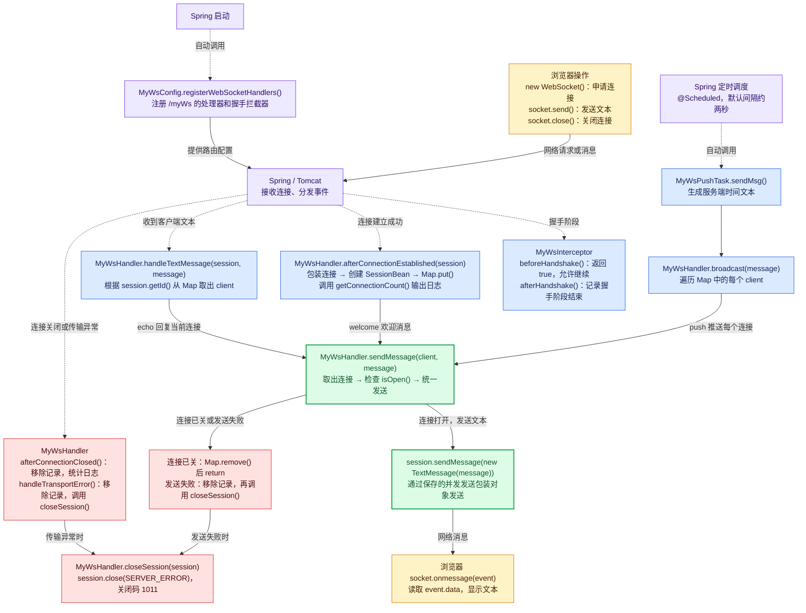

# WebSocket 方法调用关系图

从浏览器开始，沿箭头看事件如何进入后端。虚线表示 Spring 根据事件自动调用方法，实线表示代码执行、配置关系或消息传递。

三个发送入口都汇合到绿色的 `sendMessage(client, message)`：欢迎消息、文本回复、定时推送共用这个方法，再由连接对象的 `sendMessage(TextMessage)` 发送出去。

`afterHandshake()` 表示握手处理阶段结束；连接关闭由 `afterConnectionClosed()` 处理。图中按事件画出回调，业务代码无需依赖 `afterHandshake()` 与连接建立回调之间固定的先后顺序。

`getConnectionCount()` 内部调用 `sessionBeanMap.size()`，给连接建立和关闭时的日志提供数量。

源码：[配置](../backend/src/main/java/com/syf/blog/test/MyWsConfig.java)、[握手拦截器](../backend/src/main/java/com/syf/blog/test/MyWsInterceptor.java)、[消息处理器](../backend/src/main/java/com/syf/blog/test/MyWsHandler.java)、[定时推送](../backend/src/main/java/com/syf/blog/test/MyWsPushTask.java)、[连接记录](../backend/src/main/java/com/syf/blog/test/SessionBean.java)、[浏览器页面](../backend/src/main/resources/static/ws-client.html)。
